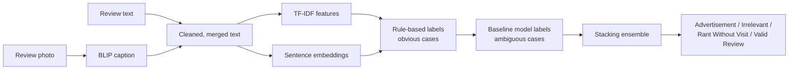

# Review Quality Classifier

Multimodal pipeline that flags low-quality Google location reviews (advertisements, irrelevant content, rants from non-visitors) so that moderators only need to look at the ambiguous ones.

Built by a team of five for **TikTok TechJam 2025**.



## The problem

Review platforms have no labelled data for "bad" reviews, and manual moderation does not scale. We needed a classifier that could:

- sort reviews into four classes: `Advertisement`, `Irrelevant`, `Rant Without Visit`, `Valid Review`
- use both the review text and the attached photo
- be trained without a labelled dataset

## Approach

| Stage | What it does | Tools |
|---|---|---|
| 1. Image captioning | Turns each review photo into a text caption and merges it with the cleaned review text | BLIP (Hugging Face Transformers) |
| 2. Feature engineering | Represents each review as keyword features plus a semantic embedding | TF-IDF, Sentence-Transformers |
| 3. Pseudo-labelling, rule stage | Labels the obvious cases with high-confidence rules | Pandas |
| 4. Pseudo-labelling, model stage | Trains a baseline on the rule-labelled rows, then labels the remaining ambiguous rows | scikit-learn `LogisticRegression` |
| 5. Final classifier | Stacking ensemble: one base model each for hand-crafted features, TF-IDF and embeddings, combined by a logistic regression meta-model | scikit-learn, LightGBM |

**Why two-stage pseudo-labelling:** rules alone are precise but cover few reviews; a model alone has nothing to learn from. Using rules to seed a baseline model gave us labels for the whole dataset without manual annotation.

## Results

Evaluated on a 20% hold-out (297 reviews) of the 1,482-review dataset.

| Metric | Score |
|---|---|
| Overall accuracy | 87.9% |
| Balanced accuracy | 65.4% |
| Cohen's kappa | 0.80 |

| Class | Precision | Recall | F1 | Reviews in test set |
|---|---|---|---|---|
| Advertisement | 1.00 | 1.00 | 1.00 | 70 |
| Irrelevant | 0.79 | 0.69 | 0.74 | 72 |
| Rant Without Visit | 0.00 | 0.00 | 0.00 | 2 |
| Valid Review | 0.86 | 0.92 | 0.89 | 153 |

### How to read these numbers

- **The hold-out labels are pseudo-labels, not human labels.** The scores measure how well the final model reproduces the labels generated by our own rule and baseline stages. They are not a measure of accuracy against human judgement.
- **The perfect Advertisement score is expected.** Advertisements were labelled by keyword rules, so the model is relearning those rules.
- **The pipeline cannot detect Rant Without Visit.** Only 10 reviews received that label, and none of the 2 in the test set were caught. This is why balanced accuracy (65%) is far below overall accuracy (88%).

## Known issues and what we would do next

- **Build a human-labelled test set** with a written rubric and two annotators, and re-evaluate against it.
- **Fix the image captioning stage.** The saved notebook run logs path errors for many review photos, so captions were missing for part of the data.
- **Fix the TF-IDF base model.** LightGBM reports no usable features in the saved run, so that branch of the ensemble contributed nothing.
- **Collect more Rant Without Visit examples** or merge the class, since 10 examples is too few to learn from.
- **Add unit tests for the labelling rules**, since every downstream label depends on them.
- **Package the pipeline as a script** so it runs outside Google Colab.

## Repository structure

```
notebooks/Main_Pipeline.ipynb   Full training and evaluation run, with saved outputs
src/data_preprocessing.py       Text cleaning and merging
src/image_analysis.py           BLIP image captioning
src/feature_engineering.py      TF-IDF and sentence embeddings
src/model_training.py           Pseudo-labelling, baseline and stacking ensemble
data/                           Review CSV and photo dataset
models/                         Saved baseline, ensemble and TF-IDF vectoriser
requirements.txt                Python dependencies
```

## Running it

The notebook was written for Google Colab with data stored in Google Drive.

1. Clone the repository:
   ```bash
   git clone https://github.com/Capacesse/review-quality-classifier.git
   cd review-quality-classifier
   ```
2. Install dependencies:
   ```bash
   python -m venv venv
   source venv/bin/activate      # Windows: venv\Scripts\activate
   pip install -r requirements.txt
   ```
3. Add a Hugging Face token to Colab Secrets under the name `TikTokTechJam2025`.
4. Copy the `data/` folder to your Google Drive project directory. It should look like this:
   ```
   data/
   ├── merged_reviews_4.csv
   └── dataset/
       ├── indoor_atmosphere/
       ├── menu/
       ├── outdoor_atmosphere/
       └── taste/
   ```
5. Open `notebooks/Main_Pipeline.ipynb` in Colab and run all cells.

The dataset was provided by TikTok to TechJam 2025 participants.

## Team

| Member | Role |
|---|---|
| Julius Ng Hwee Chong | Project lead: scoped the problem, designed the pipeline architecture, coordinated integration |
| Phoa Li Lynn Sheryl | Data preprocessing |
| Park Soohwan | Feature engineering |
| Danny Lee Han Keat | Model development and pseudo-labelling |
| Mahesh Sanjana | Policy and evaluation |
